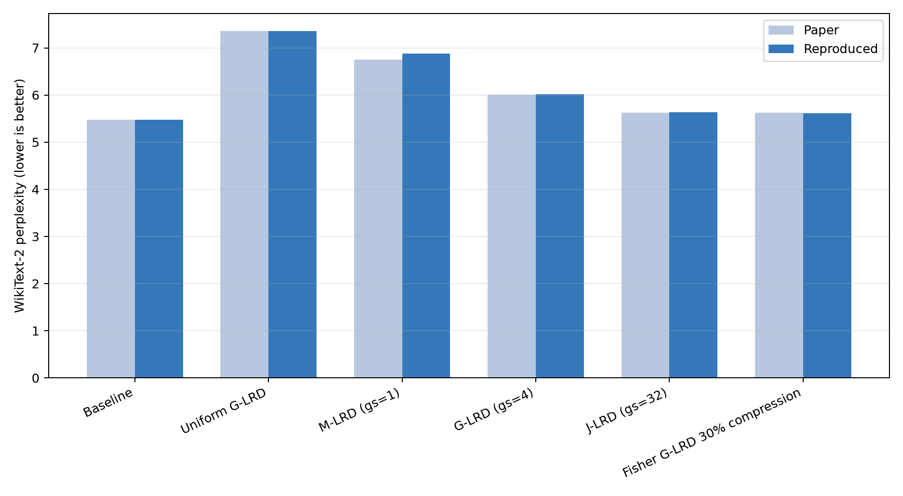
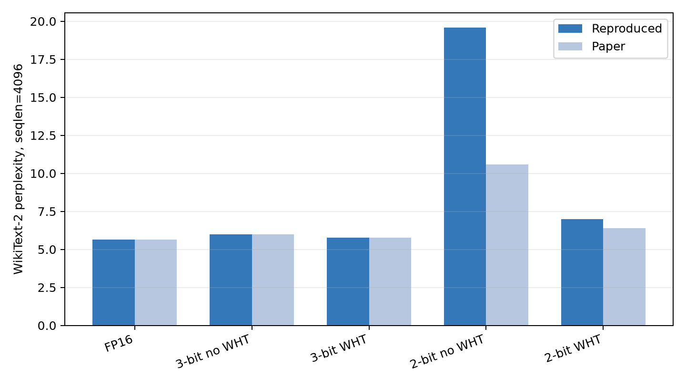

# Palu: Compressing KV-Cache with Low-Rank Projection 复现报告

## 1. 论文信息

论文为 *Palu: KV-Cache Compression with Low-Rank Projection*，Chi-Chih Chang 等，ICLR 2025。论文提出在已有 LLM 上进行 post-training 的 KV-Cache 隐藏维度压缩；附件版本为 ICLR 2025 会议论文，代码为仓库当前提交 `bb22666e2ef96707e8dd21d93fc00146c2e0d615`。原论文链接是 <https://proceedings.iclr.cc/paper_files/paper/2025/file/7da6e0e00702c60607a6ae05c802ef85-Paper-Conference.pdf>，开源代码为 <https://github.com/shadowpa0327/Palu>。

本复现使用 Llama-2-7B 权重（<https://www.modelscope.cn/models/modelscope/Llama-2-7b-ms/>），复现内容包括 50% 压缩主表、WikiText-2/C4 困惑度、G-LRD 组大小消融、Fisher 秩分配、低比特量化和 Triton 重建内核。

## 2. 研究动机与方法

自回归解码需要保存历史 Key/Value。序列变长后，KV-Cache 同时受显存容量和内存带宽限制。已有 token eviction 或量化主要沿 token 数和数值位宽压缩，忽略了 KV 向量隐藏维度中的冗余。

Palu 将 Key/Value 投影矩阵离线近似为低秩乘积 `W ≈ A B`。推理时缓存较短的 `h=xA`，需要时用 `B` 恢复 Key/Value。方法包含四个模块：

1. **G-LRD**：按多个 attention head 组成中等大小的组，在组内共享低秩子空间。`gs=1` 是 M-LRD，`gs=32` 是 J-LRD，`gs=4` 是论文默认设置。
2. **Fisher rank search**：使用 WikiText-2 校准样本累积目标投影的梯度平方，按 Fisher 重要性分配总秩；Value 通常保留更高秩。
3. **矩阵融合与 WHT**：将 Value 重建矩阵并入 output projection；将 Walsh-Hadamard 变换左右吸收到低秩矩阵，消除 SVD 诱导的 latent outlier，而不增加在线矩阵乘法。
4. **RoPE Triton kernel**：把 Key 重建、RoPE 和 query-key GEMV 融合，减少长上下文解码时的显存读写。

## 3. 复现环境、数据与工程

实验在 4× NVIDIA A100-PCIE-40GB 主机完成，单个任务使用一张卡。完整环境记录在 [`reproduction/results/environment.json`](reproduction/results/environment.json)，模型文件记录在 [`reproduction/results/model_manifest.json`](reproduction/results/model_manifest.json)。关键版本为 Python 3.12.16、PyTorch 2.11.0+cu130、CUDA runtime 13.0、Transformers 4.37.2、Triton 3.6.0。依赖统一记录在仓库根目录 [`requirements.txt`](requirements.txt)；在 `conda activate LLM-hw1` 后，直接调用该环境中的全局 `uv` 安装，不创建额外虚拟环境。

数据固定为 WikiText-2 raw `Salesforce/wikitext` revision `b08601e...`，C4 固定使用论文原代码的 validation shard revision `607bd4...` 和前 1100 条文本。每个数据文件和来源 URL 的 SHA256 在 [`reproduction/data/manifest.json`](reproduction/data/manifest.json)、[`reproduction/data/c4_manifest.json`](reproduction/data/c4_manifest.json)。

核心脚本如下：`prepare_data.py` 下载数据；`calibrate.py` 执行白化/Fisher 校准；`merge_fisher.py` 合并多 GPU 分片；`compress_model.py` 生成 HuggingFace 格式压缩模型；`evaluate.py` 和 `evaluate_suite.py` 测 PPL/量化；`benchmark_kernel.py` 测 Triton 内核；`check_core.py` 做分解、融合和量化数值检查。最小完整流程见 [`reproduction/run_reproduction.sh`](reproduction/run_reproduction.sh)。

## 4. 复现步骤与参数

下面的命令都在仓库根目录执行。每一步后附有用途说明，便于按需单独运行；完整串行流程也写在 [`reproduction/run_reproduction.sh`](reproduction/run_reproduction.sh) 中。

### 4.1 激活环境并安装依赖

```bash
cd /home/wangfy26/workspace/LLM-hw1
source /home/wangfy26/miniconda3/etc/profile.d/conda.sh
conda activate LLM-hw1
UV_CACHE_DIR=/tmp/llm-hw1-uv-cache uv pip install -r requirements.txt
```

若环境已经满足依赖，可跳过安装命令。

### 4.2 准备数据

```bash
python reproduction/scripts/prepare_data.py
python reproduction/scripts/prepare_c4.py
```

第一个脚本下载 WikiText-2 的 train/test 数据，用于 Fisher/白化校准和 PPL；第二个脚本下载论文原代码使用的 C4 validation 分片前 1100 条文本。脚本会固定 Hugging Face revision 并写入 SHA256 清单，保证数据版本可追溯。

### 4.3 运行未压缩基线

```bash
CUDA_VISIBLE_DEVICES=0 python reproduction/scripts/evaluate.py \
  --output reproduction/results/baseline_2048.json --sample
CUDA_VISIBLE_DEVICES=0 python reproduction/scripts/evaluate.py \
  --seqlen 4096 --output reproduction/results/baseline_4096.json
CUDA_VISIBLE_DEVICES=0 python reproduction/scripts/evaluate.py \
  --dataset c4 --output reproduction/results/baseline_c4.json
```

三个命令分别对应 WikiText-2 长度 2048、论文量化表使用的 WikiText-2 长度 4096，以及 C4。`--sample` 会额外保存固定提示词的 greedy generation 样例。评测使用完整测试文本切分出的不重叠窗口，结果 JSON 同时记录窗口数、token hash、耗时和显存峰值。

### 4.4 计算白化矩阵和 Fisher 信息

```bash
CUDA_VISIBLE_DEVICES=0 python reproduction/scripts/calibrate.py \
  --kind whiten --samples 256 --seqlen 2048
CUDA_VISIBLE_DEVICES=1 python reproduction/scripts/calibrate.py \
  --kind fisher --samples 2048 --seqlen 1024 --shard 0 --shards 2
CUDA_VISIBLE_DEVICES=2 python reproduction/scripts/calibrate.py \
  --kind fisher --samples 2048 --seqlen 1024 --shard 1 --shards 2
python reproduction/scripts/merge_fisher.py
```

白化阶段为每层 Key 投影累积输入 Gram 矩阵并做 Cholesky 分解；Fisher 阶段对 Key/Value 投影累积梯度平方。论文设置是 Fisher 2048 个 WikiText-2 样本、长度 1024，白化 256 个样本、长度 2048。两个 Fisher 分片各处理 1024 个样本，合并时先合并梯度平方和再开方。随机种子为校准 3、模型和评测 42。

### 4.5 生成并评测压缩模型

```bash
CUDA_VISIBLE_DEVICES=0 python reproduction/scripts/compress_model.py \
  --group-size 4 --ratio 0.5 --output reproduction/checkpoints/g4_r50
CUDA_VISIBLE_DEVICES=0 python reproduction/scripts/evaluate_suite.py \
  --model reproduction/checkpoints/g4_r50 --name g4_r50 --quantization
```

`--group-size 4` 是论文默认 G-LRD；`--ratio 0.5` 表示保留约 50% 的 KV latent rank，秩会按 32 对齐，取整后的真实比例写入 `reproduction.json`。`evaluate_suite.py` 会测 WikiText-2/C4、FP16，以及 3-bit/2-bit、带/不带 Hadamard 的量化消融。

组大小消融可使用相同流程替换参数：`--group-size 1` 对应 M-LRD，`--group-size 32` 对应 J-LRD；等秩基线使用 `compress_model.py --uniform --group-size 4 --ratio 0.5`。

### 4.6 检查核心模块和测量内核

```bash
python reproduction/scripts/check_core.py
CUDA_VISIBLE_DEVICES=0 python reproduction/scripts/benchmark_kernel.py
MPLCONFIGDIR=/tmp/mpl python reproduction/scripts/make_report_assets.py
```

`check_core.py` 检查全秩/截断 SVD、Hadamard 融合、Value 矩阵融合和量化输出；`benchmark_kernel.py` 验证 Triton 内核的相对误差并测量 A100 上 4K/16K/64K 序列；最后一个命令生成 PPL、量化和 Fisher 曲线图。论文速度实验使用 RTX 4090，因此内核延迟只用于本机 A100 的实现验证。

## 5. 结果

### 5.1 WikiText-2 主表和组大小

下表的 2048 结果使用 WikiText-2 test 全部 166 个不重叠窗口；论文值来自附件 Table 1/Table 8。`gs=1/4/32` 分别对应 M-/G-/J-LRD。所有逐窗口 NLL、token hash 和运行时间在对应 JSON 中。

| 方法 | 论文 PPL | 复现 PPL | 差值 |
|---|---:|---:|---:|
| Baseline | 5.47 | **5.4721** | +0.0021 |
| Uniform rank, 50% | 7.36 | **7.3567** | -0.0033 |
| M-LRD, gs=1, 50% | 6.75 | 6.8782 | +0.1282 |
| G-LRD, gs=4, 50% | 6.01 | **6.0179** | +0.0079 |
| J-LRD, gs=32, 50% | 5.62 | **5.6299** | +0.0099 |
| Fisher G-LRD, 30% compression | 5.62 | **5.6163** | -0.0037 |



论文 Table 2 采用长度 4096，因此额外测得 Baseline **5.1164**（论文 5.12）、G-LRD 50% **5.6330**（论文 5.63）、G-LRD 30% **5.2530**（论文 5.25）。C4 的 256 个窗口基线为 **7.2636**（论文 7.26），G-LRD 50% 为 **8.7166**，G-LRD 30% 为 **7.5894**。C4 压缩值没有论文 Table 1 的直接对照项，但原始 JSON 已保存。

### 5.2 量化消融

量化是 per-token asymmetric fake quantization，长度 4096。论文值和复现值如下；论文的 WHT 结果基本对齐 3-bit，2-bit 结果出现明显差距。

| 配置 | 论文 PPL | 复现 PPL |
|---|---:|---:|
| G-LRD 50%, FP16 | 5.63 | **5.6330** |
| +3-bit, 无 WHT | 5.99 | 5.9790 |
| +3-bit, WHT | 5.77 | **5.7607** |
| +2-bit, 无 WHT | 10.58 | 19.5738 |
| +2-bit, WHT | 6.41 | 6.9945 |
| G-LRD 30%, FP16 | 5.25 | **5.2530** |
| +3-bit, WHT | 5.33 | 5.3437 |
| +2-bit, WHT | 5.76 | 6.1062 |



**差距分析。** 这组差异主要出现在 2-bit：50% 压缩下，无 WHT 的 PPL 比论文高 8.99；加 WHT 后差距缩小到 0.58。30% 压缩、2-bit+WHT 的差距为 0.35。相比之下，3-bit 两种设置与论文相差不超过 0.02，FP16 基线及压缩结果也都对齐。因此，模型权重、数据集切分和整体 PPL 计算流程不像是造成 2-bit 偏差的主要因素，偏差更可能来自极低位宽下量化参数和算子实现的细节。

2-bit asymmetric quantization 只有 4 个整数码，scale 为 `(max-min)/3`，zero-point 又由 `-min/scale` 舍入得到。少量 latent outlier 会显著改变 min/max；scale 或 zero-point 的微小数值变化也可能让大量值跨过量化边界。仓库的 [quant.py](../palu/model/modules/quant.py) 在输入 latent 的 dtype 上直接计算 min/max、scale 和 zero-point，而模型 latent 是 FP16；该路径没有显式将这些统计量提升到 FP32。论文给出了 per-token asymmetric 方法，但没有在正文中规定统计量与舍入的中间精度。3-bit 对齐而 2-bit 偏离，与这种低位宽敏感性相符。

另外，本次准确率评测走的是 PyTorch fake-quant 路径：将 latent 量化后立即反量化为浮点数，再交给 Hugging Face attention。论文描述的低精度推理路径则使用融合反量化和矩阵乘法的 CUDA kernel。两者的量化公式相同，但中间精度和舍入执行路径未必逐值一致。WHT 将本次 50% 压缩、2-bit PPL 从 19.57 降至 6.99，改善 12.58；论文对应改善为 4.17。这说明 WHT 确实缓解了低秩分解造成的 outlier，但无 WHT 时本实现受到的量化误差更重，也提示量化实现细节可能叠加了影响。现有实验无法单独确定 FP16 统计量、WHT/latent 排布或融合算子的各自贡献，因此这里把它们作为有代码依据的可能原因，而不视为已证实的单一根因。

### 5.3 核心模块和内核

[`reproduction/results/core_checks.json`](reproduction/results/core_checks.json) 的五项检查全部通过：全秩 SVD 最大误差 `2.24e-6`，WHT 融合 `4.77e-7`，Value 融合 `9.54e-7`，截断秩可执行，量化输出有限。开源 Triton kernel 在 A100 上的相对 L2 误差为 `0.00082–0.00136`。论文使用 RTX 4090；本机 A100 的单次 attention GEMV 结果为：

| gs | 4096 speedup | 16K speedup | 64K speedup |
|---:|---:|---:|---:|
| 1 | 1.52× | 1.14× | 1.03× |
| 4 | 0.69× | 0.53× | 0.45× |
| 32 | 0.12× | 0.09× | 0.07× |

这表明内核收益依赖组大小、GPU 和 kernel autotune；不能将 A100 结果与论文 RTX 4090 的 1.89× 直接比较。内核原始结果在 [`reproduction/results/kernel.json`](reproduction/results/kernel.json)，运行日志在 [`reproduction/logs/kernel.log`](reproduction/logs/kernel.log)。

### 5.4 样例输出

Baseline greedy generation 的固定输入为 `The capital of France is`，输出保存在 [`reproduction/results/baseline_2048.json`](reproduction/results/baseline_2048.json)：

> The capital of France is a city of contrasts. The city is home to the Eiffel Tower, the Louvre, and the Arc de Triomphe. It is also home to the Notre Dame Cathedral, the Sacre Coeur, and

## 6. 问题、修复与复盘

1. 仓库的 `palu/model/__init__.py` 无条件导入 Qwen2，而锁定 Transformers 4.37.2 没有 Qwen2；已改为按版本条件导入。
2. 原始 `dump_to_huggingface_repos` 保存 Llama generation config 时会因 `do_sample=False` 配合 `temperature/top_p` 抛异常；保存前将采样参数归一为 1.0。
3. SVD 截断时原代码无条件断言 `AB=W`，导致真正低秩时错误；改为仅在全秩时检查精确重构。
4. 原 Hadamard dispatch 没有连接已定义的 60/52/44/40/36/28/20/12 基矩阵，Fisher 取整生成 96/160 等秩时会失败；已补齐并验证 32 倍数至 512 的正交性。
5. 原校准固定把白化样本长度写成 2048；复现脚本显式记录并执行论文的 Fisher `2048×1024` 和白化 `256×2048` 设置。
6. HF accuracy evaluator 会在 forward 中重建完整 KV；因此压缩 checkpoint 的文件大小和真实 latent KV-cache 占用不是同一指标。报告中的压缩比例按理论 latent rank 计算，速度实验单独调用重建 kernel。
7. 原始仓库的 C4 评测拼接前 1100 条验证文本，本工程固定了数据 revision 和字节校验，避免数据漂移。

## 7. 文件索引

- 报告与清单：[`reproduction/REPORT.md`](reproduction/REPORT.md)
- 结果表：[`reproduction/results/ppl_comparison.csv`](reproduction/results/ppl_comparison.csv)
- 环境/模型：[`reproduction/results/environment.json`](reproduction/results/environment.json)、[`reproduction/results/model_manifest.json`](reproduction/results/model_manifest.json)
- 结果图：[`reproduction/figures/ppl_comparison.png`](reproduction/figures/ppl_comparison.png)、[`reproduction/figures/quantization_ablation.png`](reproduction/figures/quantization_ablation.png)、[`reproduction/figures/fisher_profile.png`](reproduction/figures/fisher_profile.png)
- 原始日志：[`reproduction/logs/`](reproduction/logs/)
